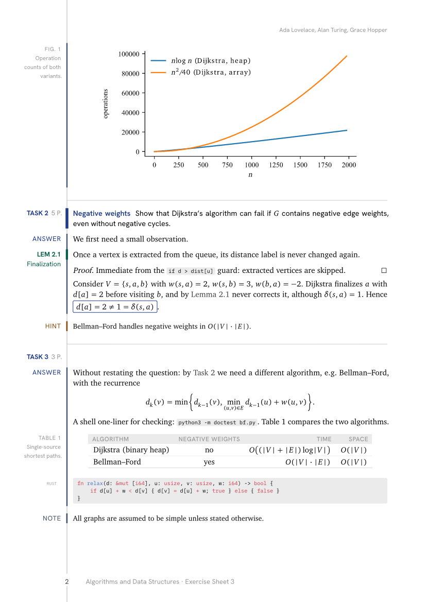
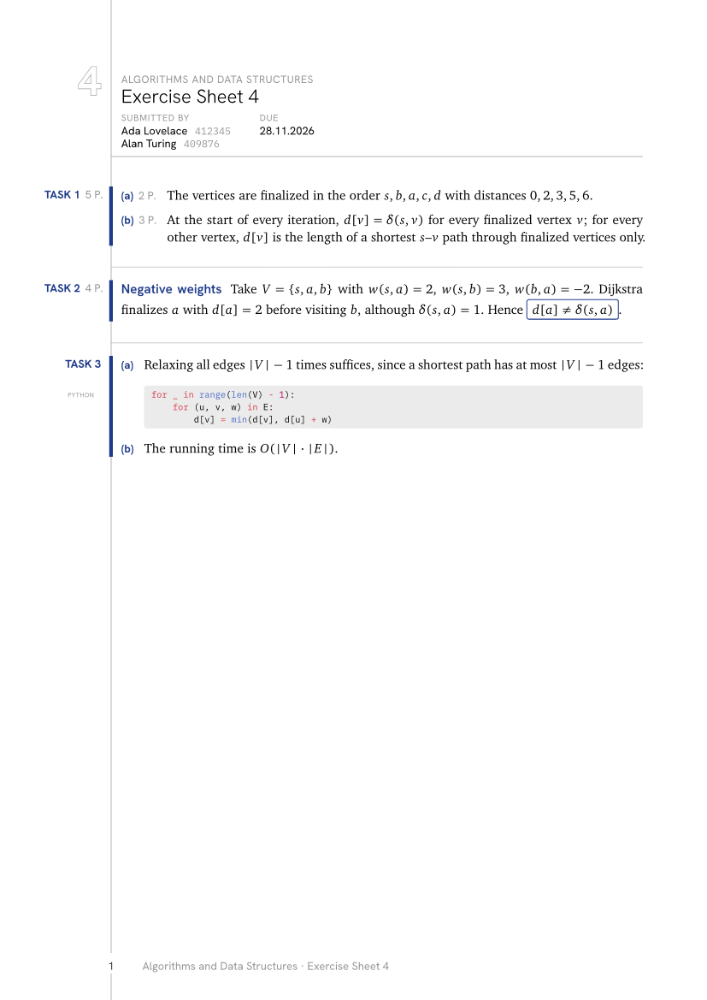
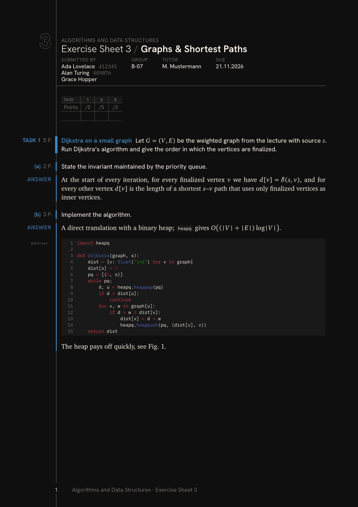

# obelisk-assignment

Typst template for typesetting solutions to exercise sheets: tasks and sub-tasks
with points, answer blocks, code listings and figures.

The design is adapted from [obelisk-lite](https://github.com/atzlt/obelisk-lite)
by atzlt and keeps its Bauhaus-inspired approach: a fixed baseline grid, a
margin column separated by a vertical rule, and no ornament. Light and dark
themes are included.

<p>
  
  
  
  
</p>

## Getting started

Install the template once as a local Typst package (macOS and Linux):

```bash
git clone https://github.com/s-rode/obelisk-assignment
cd obelisk-assignment
./install.sh
```

Then start a new sheet anywhere:

```bash
typst init @local/obelisk-assignment:0.1.0 sheet-03
cd sheet-03
typst watch main.typ
```

This creates `sheet-03/main.typ` with the title block and one example of each
environment. Edit the `sheet.with(...)` arguments at the top, delete what you
don't need, and write your answers. The template files are not copied into the
sheet folder, so every sheet stays a single file.

For an existing file, import it directly:

```typst
#import "@local/obelisk-assignment:0.1.0": *
```

To change the template itself (colors, margins, labels), edit the cloned folder
and run `./install.sh` again. With `./install.sh --link` the installed package
points at the folder instead of a copy, so edits apply immediately. Fonts are
listed under [Fonts](#fonts). To use a different layout for a single sheet,
no template edit is needed: pass e.g. `margin: (e: 3cm)` or `texts: (size: 10pt)`
to `sheet.with(...)`.

## Usage

```typst
#import "@local/obelisk-assignment:0.1.0": *

#show: sheet.with(
  course: "Algorithms and Data Structures",
  number: 3,
  title: "Shortest Paths",
  authors: ((name: "Ada Lovelace", id: "412345"), "Alan Turing"),
  group: "B-07",
  tutor: "M. Mustermann",
  due: "21.11.2026",
  lang: "en", // or "de"
  theme: "default", // e.g. "flexoki-dark", "rose-pine"
)

#task[Dijkstra][Run Dijkstra's algorithm on $G$ …]

#part(points: 2)[State the invariant.]
#answer[At every iteration …]

#part(points: 3)[Implement it.]
#answer[
  #code(title: "dijkstra.py", numbers: true)[```python
  def dijkstra(graph, s): ...
  ```]
]

#task(points: 4) <t2>
#solution[By @t2 … #result[$x = 3$]]
```

All fields of `sheet.with(...)` are optional. See [`example.typ`](example.typ)
for a complete sheet and [CONFIGURATION.md](CONFIGURATION.md) for all options.

## Two modes

**Questions** (default): each question is restated with `task` and `part`,
and answered below it with `answer`.

**Answers**: only the answers are written down. Set `mode: "answers"` in
`sheet.with(...)`; `task` and `part` then contain the answer itself, and parts
go inside their task:

```typst
#show: sheet.with(course: "…", number: 4, mode: "answers")

#task(points: 5)[
  #part(points: 2)[Answer to (a).]
  #part(points: 3)[Answer to (b).]
]
#task[Negative weights][Answer to a task without parts.]
```

See [`example-answers.typ`](example-answers.typ). Points are optional in both
modes.

## Environments

- `task`, `part`: exercise and sub-exercise (a), (b), …. Title, text and
  `points:` are optional. A task without points shows the sum of its parts.
- `answer`, `solution`: answer blocks. `label: none` hides the margin label.
- `hint`, `note`: unnumbered callouts.
- `result[...]`: frames a final result.
- `lemma`, `claim`, `theorem`, `definition`, …, `proof`: numbered per task
  (Lemma 2.1).
- Code: fenced ```` ```lang ```` blocks are styled automatically.
  `#code(title: .., numbers: true)` adds a file name or line numbers.
- `plot(...)`, `figure(...)`: see [Plots](#plots).
- Tables: plain `table(...)` gets a tinted header row and hairlines between
  rows. Wrap it in `figure(..., caption: [...])` for a numbered table with the
  caption in the margin.
- References: `@t2` → "Task 2", parts → "Task 2(b)", lemmas → "Lemma 2.1".
  `@x[!]` prints the title.

Questions are set in the sans font and answers in the body font. An answer
has a thin bar and label in the task's color, and a hairline separates tasks.
Change this with `tasks: (style: ("sans", "bars", "tint"))`, any subset works,
`()` turns it off.

A points table and a total column are available but disabled by default:
`show-points-table: true`, `show-points-total: true`.

## Themes

`default`, `monochrome`, `github-light`, `one-light`, `solarized-light`,
`everforest-light`, `catppuccin-latte`, `rose-pine-dawn`, `flexoki-light`,
and the dark themes `flexoki-dark`, `rose-pine-moon` and `rose-pine`.
All template elements (code blocks, captions, title block) follow the theme.

## Plots

```typst
#plot(image("figs/loss.svg"), caption: [Training loss.], width: 70%) <fig-loss>
```

The caption is placed in the margin; a plain `#figure(image(...))` is styled
the same way. Pass `image(...)` rather than a path string so the path resolves
relative to your document.

Recommended matplotlib export (vector output, transparent background):

```python
plt.rcParams.update({"font.family": "serif", "font.size": 9, "svg.fonttype": "none"})
fig.savefig("figs/loss.svg", bbox_inches="tight", transparent=True)
```

For dark themes, additionally use light axes and labels, e.g.
`plt.style.use("dark_background")`.

## Fonts

XCharter with XCharter Math, Hanken Grotesk and IBM Plex Mono. On macOS:

```bash
brew install --cask font-hanken-grotesk font-ibm-plex-mono
```

XCharter and XCharter Math are available from CTAN
([xcharter](https://ctan.org/pkg/xcharter),
[xcharter-math](https://ctan.org/pkg/xcharter-math)) and ship with TeX Live
(`texmf-dist/fonts/opentype/public/xcharter` and `.../xcharter-math`). Missing fonts are
replaced by fallbacks, with a compiler warning.

## License

MIT, as the original template.
