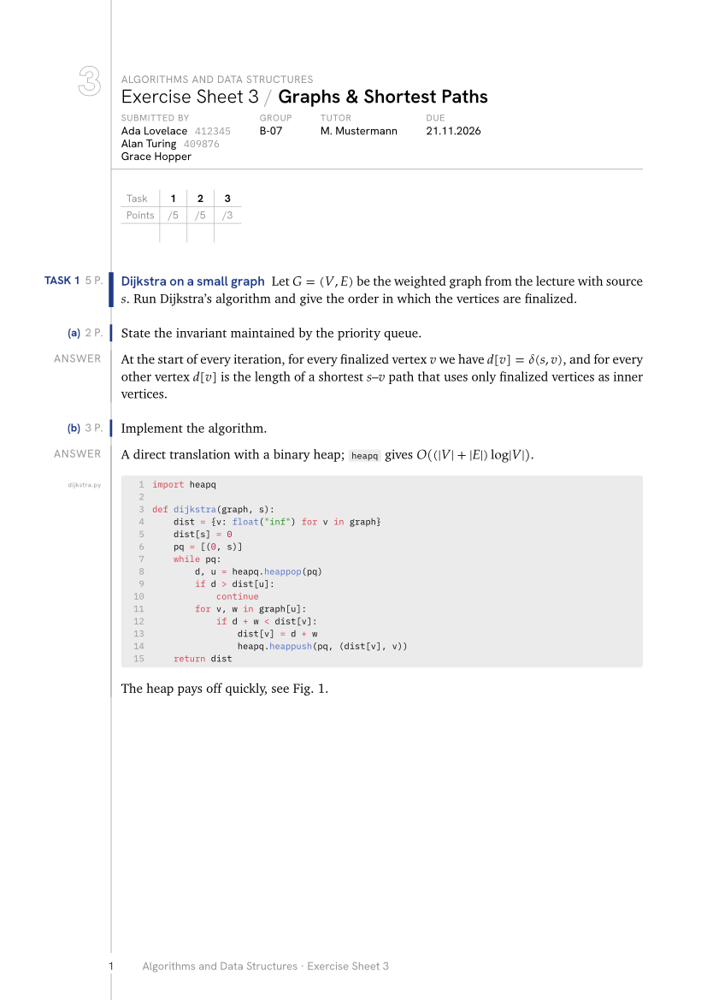

# obelisk-assignment

Typst template for handing in exercise sheets. Fork of
[obelisk-lite](https://github.com/atzlt/obelisk-lite) by atzlt. I liked the look
but needed something for assignments instead of lecture notes.

<p> </p>

## Usage

```typst
#import "lib.typ": *

#show: sheet.with(
  course: "Algorithms and Data Structures",
  number: 3,
  title: "Shortest Paths",
  authors: ((name: "Ada Lovelace", id: "412345"), "Alan Turing"),
  group: "B-07",
  tutor: "M. Mustermann",
  due: "21.11.2026",
  lang: "en", // or "de"
)

#task[Dijkstra][Run Dijkstra's algorithm on $G$ …]

#part(points: 2)[State the invariant.]
#answer[At every iteration …]

#part(points: 3)[Implement it.]
#answer[
  #code(title: "dijkstra.py", numbers: true)[```python
  def dijkstra(graph, s): ...
  ```]
]

#task(points: 4) <t2>
#solution[By @t2 … #result[$x = 3$]]
```

All the fields in `sheet.with(...)` are optional. Full example in
[`example.typ`](example.typ), all options in [CONFIGURATION.md](CONFIGURATION.md).

## What's in it

- `task`, `part`: exercise and sub-exercise (a), (b), …. Title, question text and `points:` are all optional. If a task has no points, it adds up the points of its parts.
- `answer`, `solution`: for your answers. `label: none` hides the margin label.
- `hint`, `note`: small callouts.
- `result[...]`: draws a box around the final answer.
- `lemma`, `claim`, `theorem`, `definition`, …, `proof`: numbered per task (Lemma 2.1).
- Code blocks: normal ```` ```lang ```` fences are styled automatically. Use `#code(title: .., numbers: true)` for a file name or line numbers.
- `plot(...)` / `figure(...)`: see below.
- References: `@t2` gives "Task 2", a part gives "Task 2(b)", a lemma gives "Lemma 2.1". `@x[!]` prints the title instead.

There's no points table or total by default since the grader does that anyway.
Turn them on with `show-points-table: true` and `show-points-total: true`.

## Plots

```typst
#plot(image("figs/loss.svg"), caption: [Training loss.], width: 70%) <fig-loss>
```

The caption goes in the margin. A plain `#figure(image(...))` looks the same.
Pass `image(...)` and not just the path, otherwise Typst looks for the file
relative to the template.

For matplotlib I export SVG with a transparent background, so it also works
with the dark themes:

```python
plt.rcParams.update({"font.family": "serif", "font.size": 9, "svg.fonttype": "none"})
fig.savefig("figs/loss.svg", bbox_inches="tight", transparent=True)
```

## Fonts

XCharter, Hanken Grotesk, IBM Plex Mono and TeX Gyre Pagella Math. On macOS:

```bash
brew install --cask font-hanken-grotesk font-tex-gyre-pagella-math font-ibm-plex-mono
```

XCharter isn't on Homebrew. Get it from [CTAN](https://ctan.org/pkg/xcharter),
or copy it out of your TeX Live install
(`texmf-dist/fonts/opentype/public/xcharter`). Without these fonts it still
compiles with fallback fonts, you just get warnings.

MIT, same as upstream.
